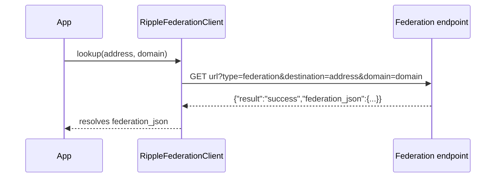

# payments-federation-client

A small JavaScript client that resolves a name such as `joseph@example.com` to a Ripple payment destination using the Internet Payments Federation Protocol.

> [!NOTE]
> Dormant since 2015-04-12 (two commits, one day). Written for the Ripple federation era with Babel 5, gulp 3 and superagent 1.x; the dependencies are from 2015 and were not run on current Node in this pass. There are no tests.

## What it does

`RippleFederationClient` wraps one HTTP call. You give it the URL of a federation endpoint, then `lookup(address, domain)` sends a federation request and returns a Promise for the `federation_json` record (destination address, destination tag, currencies) or rejects with a typed error.

## How it works



Response handling in `src/index.js`:

| Server answer | Promise outcome |
|---|---|
| HTTP/network error | rejects with `FederatedNameNotFoundError` ("federated name not found") |
| `result: "success"` | resolves with `federation_json` |
| `result: "error"` | rejects with `FederatedNameError` carrying `error_message` |
| anything else | rejects with the raw response body |

`FederatedNameError` is not exposed on `client.Errors` (only `NameNotFound` is), so check `error.message` for it.

The server half of the pair is [payments-federation-builder](https://github.com/stevenzeiler/payments-federation-builder), which produces responses in exactly this shape.

## Getting started

The package is not published from this repo; install from a checkout.

```bash
npm install
node_modules/.bin/gulp      # compiles src/ to build/ with gulp-babel (the default task)
```

`package.json` has no `build` script, and `npm test` is the npm placeholder that exits with an error. The compiled `build/index.js` is committed and is the package `main`.

## Usage

```js
var Federation = require('payments-federation-client')   // build/index.js; its last line is module.exports = the class
var client = new Federation('https://example.com/ripple.federation')   // endpoint URL

client.lookup('joseph', 'example.com')
  .then(function (record) { console.log(record.destination_address, record.destination_tag) })
  .catch(function (error) { console.error(error.message) })
```

The ES6 source default-exports the class; the Babel 5 output ends with `module.exports = exports['default']`, so `require` returns the class directly (read from `build/index.js`, not run). `client.Errors.NameNotFound` exposes the not-found error class. The client currently `console.log`s each request URL.

## Project history

Created 2015-04-12 as "Internet Payments Federation Protocol Client" and finished the same day by registering the repository in `package.json`. Sibling of ripple-txt-client; the server counterpart followed on 2015-04-16.

## License

ISC, as declared in `package.json`. There is no LICENSE file in the repo.
